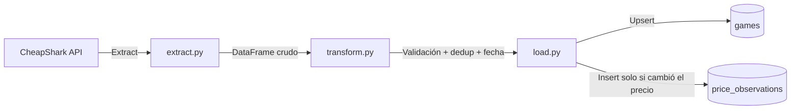

# GameDeals Pipeline

Pipeline de datos que extrae precios de videojuegos desde la API pública de [CheapShark](https://www.cheapshark.com/api/1.0/games), los transforma con pandas, y los almacena en SQLite manteniendo un histórico de precios a lo largo del tiempo. Es la base de datos de **DealSense**, un proyecto en construcción para analizar oportunidades de compra reales, no solo listar descuentos.

## Flujo del pipeline



## Stack

- **Python 3.14**
- **requests** — consumo de la API externa
- **pandas** — limpieza y transformación de datos
- **SQLite** — persistencia (vía `sqlite3`, incluido en la librería estándar)
- **logging** — trazabilidad de cada corrida (consola + `pipeline.log`)
- **pytest** — pruebas automatizadas de `transform.py`

## Cómo correrlo

```bash
python -m venv venv
venv\Scripts\activate.bat
pip install -r requirements.txt
python main.py
```

Los juegos a trackear se configuran en `config.json`, sin tocar código:

```json
{
    "juegos": ["zelda", "elden ring", "hollow knight"]
}
```

Para correr las pruebas:

```bash
pytest -v
```

## Esquema de datos

- **`games`**: una fila por juego, identificada por `gameID` (el identificador estable que entrega CheapShark — no el texto de búsqueda). Guarda `external` (nombre a mostrar), `internal_name`, `thumb`, y `ultima_verificacion` (se actualiza en **cada** corrida, haya cambiado el precio o no).
- **`price_observations`**: el historial real. Se inserta una fila nueva **solo cuando el precio cambia** respecto a la última observación guardada para ese juego — evita inflar la tabla con el mismo número repetido día tras día, sin perder la capacidad de saber cuándo fue la última verificación (eso lo cubre `ultima_verificacion` en `games`).

## Decisiones de diseño

- **Histórico en vez de snapshot único**: el pipeline construye su propio historial corriendo periódicamente — CheapShark no provee un historial de precios con fechas, solo el precio más bajo actual.
- **`gameID` como identificador, no `external`**: `external` es el texto del listado que matchea la búsqueda (puede haber varios productos distintos — juego base, soundtrack, DLC — para una misma búsqueda). `gameID`, que la API también entrega, es el identificador estable real.
- **Separar `games` de `price_observations`**: evita repetir datos del juego (nombre, imagen) en cada observación de precio.
- **Solo registrar cambios de precio, no cada corrida**: reduce redundancia sin perder la señal de "¿seguimos chequeando este juego?" (eso lo da `ultima_verificacion`).
- **SQLite en vez de un servidor de base de datos**: alcance de un pipeline personal, sin usuarios concurrentes.
- **Configuración separada del código** (`config.json`).
- **Manejo de errores por ítem**: si falla la extracción de un juego puntual, el pipeline continúa con el resto.
- **Fallos de carga visibles**: si la escritura a la base falla, el pipeline lo loguea como error real, no como éxito silencioso.

## Limitaciones conocidas

- **CheapShark no refleja el pricing regional de Argentina.** Confirmado con datos reales: el mismo día, en la misma moneda (USD), Steam Argentina mostraba Hollow Knight a $4.99 mientras CheapShark reportaba $14.99 para el mismo juego — Valve aplica pricing distinto por país, y CheapShark trackea precios de referencia internacional/EE.UU., no el precio que paga un usuario argentino.
  - **Camino de solución verificado** (no implementado aún): CheapShark ya entrega `steamAppID` por juego, y la API no oficial de Steam (`store.steampowered.com/api/appdetails?appids={id}&cc=ar&filters=price_overview`) devuelve el precio real por país. Probado en vivo el 29/10/2026: devolvió $4.99 USD, 0% de descuento — coincide exactamente con el precio real observado en Steam. Cubre solo precios de Steam (no las otras tiendas que trackea CheapShark), y solo para juegos presentes en Steam.
- **`cheapest` es "el precio más bajo ahora", no un histórico.** La API no entrega fecha de cuándo fue ese precio ni una serie temporal — por eso este pipeline construye su propio historial.
- **El historial recolectado antes del 29/10/2026** (antes de capturar `gameID`) no se pudo migrar de forma confiable al esquema actual y fue descartado — no había un identificador estable para esas filas.

## Orquestación

Actualmente programado con **Task Scheduler de Windows**. En un entorno productivo, se orquestaría con una herramienta como **Apache Airflow** — fuera del alcance de este proyecto personal, pero el paso natural para escalarlo.

## Próximos pasos

- **Incorporar precio real por región (Argentina)** usando `steamAppID` + la API de Steam (`cc=ar`) — verificado funcionando, es la prioridad siguiente para que los datos reflejen lo que un usuario argentino realmente paga.
- Módulo de análisis de oportunidad de compra (basado en reglas, con explicación de cada resultado) sobre `price_observations`
- Exponer los datos vía una API (FastAPI) para consumo de un frontend
- Dashboard simple para visualizar la evolución de precios
- Migrar la orquestación a Airflow