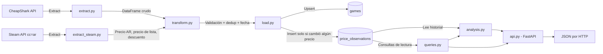

# GameDeals Pipeline

Pipeline de datos que extrae precios de videojuegos desde la API pública de [CheapShark](https://www.cheapshark.com/api/1.0/games), los enriquece con el precio real en Argentina (vía Steam), los transforma con pandas, y los almacena en SQLite manteniendo un histórico de precios a lo largo del tiempo. Sobre ese histórico se construye **DealSense**: un análisis basado en reglas que dice si un precio es una oportunidad real o conviene esperar, expuesto mediante una API con FastAPI.

## Flujo del sistema



## Stack

- **Python 3.14**
- **requests**: consumo de las APIs externas (CheapShark + Steam)
- **pandas**: limpieza y transformación de datos
- **SQLite** (vía `sqlite3`, incluido en la librería estándar): persistencia
- **FastAPI + Uvicorn**: API HTTP con documentación interactiva automática
- **logging**: trazabilidad de cada corrida (consola + `pipeline.log`)
- **pytest** (+ `httpx` para el `TestClient` de FastAPI): pruebas automatizadas

## Cómo correrlo

```bash
python -m venv venv
venv\Scripts\activate.bat
pip install -r requirements.txt
python main.py
```

Los juegos a trackear se configuran en `config.json`, sin tocar código:

```json
{
    "juegos": ["zelda", "elden ring", "hollow knight"]
}
```

Para correr las pruebas:

```bash
pytest -v
```

Para levantar la API (desde la raíz del proyecto, con el entorno virtual activo):

```bash
uvicorn api:app --reload
```

La documentación interactiva queda en `http://127.0.0.1:8000/docs`.

## API

| Endpoint | Qué devuelve |
|---|---|
| `GET /games` | Todos los juegos registrados (`gameID`, `external`, `thumb`, `ultima_verificacion`), ordenados por nombre |
| `GET /games/{id}/history` | Historial de observaciones de precio del juego, en orden cronológico. `404` si el `gameID` no existe; lista vacía si existe pero no tiene observaciones |
| `GET /games/{id}/analysis` | Análisis de oportunidad con explicación, por separado para el precio internacional y el argentino. `404` si el `gameID` no existe |
| `GET /deals` | Juegos cuya última observación tiene descuento de Steam mayor a cero, con su clasificación (profundidad del descuento y nivel de precio). Lista vacía si no hay ofertas vigentes |

La API no contiene lógica de negocio propia: traduce HTTP a llamadas a funciones de `queries.py` y `analysis.py`, que se prueban sin levantar ningún servidor.

## Esquema de datos

- **`games`**: una fila por juego, identificada por `gameID` (el identificador estable que entrega CheapShark, no el texto de búsqueda). Guarda `external` (nombre a mostrar), `internal_name`, `thumb`, y `ultima_verificacion` (se actualiza en **cada** corrida, haya cambiado el precio o no).
- **`price_observations`**: el historial real. Guarda, para cada observación, el precio internacional (`cheapest`), el precio real en Argentina (`precio_ar` + `moneda_ar`), el precio de lista de Steam (`initial_ar`) y el descuento informado (`descuento_ar`). Se inserta una fila nueva **solo cuando cambió alguno de `cheapest`, `precio_ar` o `descuento_ar`** respecto a la última observación guardada. Evita inflar la tabla con el mismo número repetido día tras día, sin perder la capacidad de saber cuándo fue la última verificación (eso lo cubre `ultima_verificacion` en `games`).

## Análisis de oportunidad (`analysis.py`)

Módulo separado, **basado en reglas** (no Machine Learning), que traduce el historial de precios en una recomendación honesta.

**Análisis de historial** (`analizar_precio`):

- Calcula el **mínimo que *nosotros* registramos** para cada juego. Nunca se lo llama "mínimo histórico", porque no sabemos el mínimo real del mercado, solo lo que DealSense observó.
- Si venimos trackeando un juego hace **menos de 7 días** (medidos desde la primera observación hasta la última verificación, no contando filas), el resultado es `"datos_insuficientes"`.
- Con suficiente historial, clasifica en `"buena_oportunidad"` (está en su mínimo registrado), `"posible_oportunidad"` (hasta un 15% por encima) o `"esperar"` (más de 15% por encima).
- Cada resultado incluye una explicación en texto, no solo una etiqueta.
- Se ejecuta **una vez por cada precio** (internacional y Argentina): el mismo juego puede ser buena oportunidad en una región y no en la otra.

**Clasificación de ofertas** (`clasificar_oferta`): usa dos etiquetas independientes, porque un 50% sobre un juego de USD 5 y sobre uno de USD 70 no significan lo mismo.

| Etiqueta | Valores |
|---|---|
| Profundidad del descuento | `sin_oferta` (0%), `menor` (<30%), `moderada` (30-49%), `buena` (50-64%), `excepcional` (≥65%) |
| Nivel de precio (sobre el precio final) | `economico` (≤USD 10), `medio` (≤USD 30), `caro` (>USD 30) |

La clasificación se apoya solo en el descuento que informa Steam en este momento: no compara contra el historial, y la explicación lo aclara.

## Decisiones de diseño

- **Histórico en vez de snapshot único**: el pipeline construye su propio historial corriendo periódicamente, porque ni CheapShark ni Steam proveen un historial de precios con fechas, solo el precio actual.
- **`gameID` como identificador, no `external`**: `external` es el texto del listado que matchea la búsqueda (puede haber varios productos distintos, como juego base, soundtrack o DLC, para una misma búsqueda). `gameID` es el identificador estable real.
- **Separar `games` de `price_observations`**: evita repetir datos del juego (nombre, imagen) en cada observación de precio.
- **Dos precios, no uno**: se guardan el precio internacional y el argentino como columnas separadas, pensando en analizar oportunidades distintas según la región del usuario.
- **Solo registrar cambios de precio, no cada corrida**: reduce redundancia sin perder la señal de "¿seguimos chequeando este juego?" (la da `ultima_verificacion`).
- **Análisis basado en reglas, no en ML**: cada resultado tiene que poder explicarse; una caja negra no cumple el objetivo del proyecto.
- **Dos etiquetas para las ofertas** (profundidad y nivel de precio) en vez de una sola escala.
- **Ofertas vigentes = última observación**: un juego que tuvo descuento hace una semana y hoy no, no es una oferta vigente.
- **404 vs lista vacía**: un `gameID` inexistente es un error del cliente (`404`); un juego que existe sin observaciones es una respuesta válida con lista vacía.
- **API sin lógica propia**: `queries.py` concentra el SQL y `analysis.py` las reglas, así todo se prueba sin servidor.
- **SQLite en vez de un servidor de base de datos**: alcance de un pipeline personal, sin usuarios concurrentes.
- **Configuración separada del código** (`config.json`).
- **Manejo de errores por ítem**: si falla la extracción de un juego puntual, el pipeline continúa con el resto.
- **Fallos de carga visibles**: si la escritura a la base falla, el pipeline lo loguea como error real, no como éxito silencioso.

## Limitaciones conocidas

- **`cheapest` y `precio_ar` son "el precio ahora", no un histórico de la API.** Ninguna de las dos fuentes entrega fecha de cuándo fue ese precio ni una serie temporal; por eso este pipeline construye su propio historial corriendo periódicamente.
- **No persistimos `steamAppID` en la base.** Se usa solo en memoria durante cada corrida para consultar el precio argentino. Queda anotado como mejora pendiente.
- **No todos los productos de CheapShark tienen `steamAppID`.** Ediciones especiales, bundles y DLCs de "ELDEN RING" no lo traen (viene `None` desde el origen), así que no se les puede calcular `precio_ar`. No es un bug, es un límite de los datos de CheapShark.
- **El listado mezcla productos distintos** (juego base, soundtracks, bundles, ediciones), porque CheapShark los devuelve juntos para una misma búsqueda.
- **El historial recolectado antes del 29/10/2026** (antes de capturar `gameID`) no se pudo migrar de forma confiable y fue descartado.
- **El análisis de historial es conservador por diseño**: hasta tener 7 días de seguimiento, el resultado esperable es `"datos_insuficientes"`.
- **`GET /deals` devuelve una lista vacía mientras no haya descuentos**: al momento de escribir esto, ningún juego trackeado con precio argentino estaba en oferta.
- **Las corridas dependen de que la PC esté encendida** a la hora programada.
- **`analizar_juego` señala el juego inexistente con un diccionario `{"error": ...}`** que la API traduce a `404`; una alternativa más robusta sería devolver `None` o lanzar una excepción.

## Orquestación

Actualmente programado con **Task Scheduler de Windows**. En un entorno productivo, se orquestaría con una herramienta como **Apache Airflow**: fuera del alcance de este proyecto personal, pero el paso natural para escalarlo.

## Próximos pasos

- **v0.5: Frontend en React + TypeScript**: búsqueda, listado de ofertas, página de detalle con historial de precios y el análisis con su explicación, watchlist simple.
- **v1.0: Automatización y pulido**: CI con GitHub Actions, migrar la orquestación a Airflow, Docker si ayuda a la reproducibilidad, documentación de arquitectura, despliegue con almacenamiento persistente.