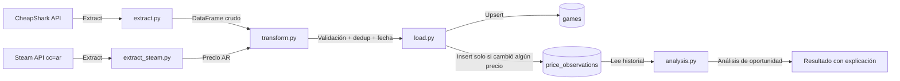

# GameDeals Pipeline

Pipeline de datos que extrae precios de videojuegos desde la API pública de [CheapShark](https://www.cheapshark.com/api/1.0/games), los enriquece con el precio real en Argentina (vía Steam), los transforma con pandas, y los almacena en SQLite manteniendo un histórico de precios a lo largo del tiempo. Es la base de **DealSense**, un proyecto en construcción para analizar oportunidades de compra reales, no solo listar descuentos.

## Flujo del pipeline



## Stack

- **Python 3.14**
- **requests** — consumo de las APIs externas (CheapShark + Steam)
- **pandas** — limpieza y transformación de datos
- **SQLite** — persistencia (vía `sqlite3`, incluido en la librería estándar)
- **logging** — trazabilidad de cada corrida (consola + `pipeline.log`)
- **pytest** — pruebas automatizadas

## Cómo correrlo

```bash
python -m venv venv
venv\Scripts\activate.bat
pip install -r requirements.txt
python main.py
```

Los juegos a trackear se configuran en `config.json`, sin tocar código:

```json
{
    "juegos": ["zelda", "elden ring", "hollow knight"]
}
```

Para correr las pruebas:

```bash
pytest -v
```

Para ver el análisis de oportunidad de un juego puntual (por `gameID` de CheapShark):

```bash
python -c "from analysis import analizar_juego; import json; print(json.dumps(analizar_juego('165363'), indent=2, ensure_ascii=False))"
```

## Esquema de datos

- **`games`**: una fila por juego, identificada por `gameID` (el identificador estable que entrega CheapShark — no el texto de búsqueda). Guarda `external` (nombre a mostrar), `internal_name`, `thumb`, y `ultima_verificacion` (se actualiza en **cada** corrida, haya cambiado el precio o no).
- **`price_observations`**: el historial real. Guarda, para cada observación, el precio internacional (`cheapest`) y el precio real en Argentina (`precio_ar` + `moneda_ar`, vía Steam). Se inserta una fila nueva **solo cuando cambió alguno de los dos precios** respecto a la última observación guardada — evita inflar la tabla con el mismo número repetido día tras día, sin perder la capacidad de saber cuándo fue la última verificación (eso lo cubre `ultima_verificacion` en `games`).

## Análisis de oportunidad (`analysis.py`)

Módulo separado, **basado en reglas** (no Machine Learning), que traduce el historial de precios en una recomendación honesta:

- Calcula el **mínimo que *nosotros* registramos** para cada juego — nunca se lo llama "mínimo histórico", porque no sabemos el mínimo real del mercado, solo lo que DealSense observó.
- Si venimos trackeando un juego hace **menos de 7 días**, el resultado es `"datos_insuficientes"` — no se arriesga una opinión sin respaldo, aunque el precio actual coincida con el mínimo visto.
- Con suficiente historial, clasifica en `"buena_oportunidad"` (está en su mínimo registrado), `"posible_oportunidad"` (cerca del mínimo, dentro de un 15%) o `"esperar"` (más de 15% por encima del mínimo).
- Cada resultado incluye una explicación en texto, no solo una etiqueta.
- Se ejecuta **una vez por cada precio** (internacional y Argentina) — el mismo juego puede ser buena oportunidad en una región y no en la otra.

## Decisiones de diseño

- **Histórico en vez de snapshot único**: el pipeline construye su propio historial corriendo periódicamente — ni CheapShark ni Steam proveen un historial de precios con fechas, solo el precio actual.
- **`gameID` como identificador, no `external`**: `external` es el texto del listado que matchea la búsqueda (puede haber varios productos distintos — juego base, soundtrack, DLC — para una misma búsqueda). `gameID`, que la API también entrega, es el identificador estable real.
- **Separar `games` de `price_observations`**: evita repetir datos del juego (nombre, imagen) en cada observación de precio.
- **Dos precios, no uno**: se guarda el precio internacional y el argentino como columnas separadas (no se reemplaza uno por el otro), pensando en analizar oportunidades distintas según la región del usuario.
- **Solo registrar cambios de precio, no cada corrida**: reduce redundancia sin perder la señal de "¿seguimos chequeando este juego?" (eso lo da `ultima_verificacion`).
- **Análisis basado en reglas, no en ML**: cada resultado tiene que poder explicarse — una caja negra no cumple el objetivo del proyecto (ayudar a entender *por qué* algo es o no una oportunidad).
- **SQLite en vez de un servidor de base de datos**: alcance de un pipeline personal, sin usuarios concurrentes.
- **Configuración separada del código** (`config.json`).
- **Manejo de errores por ítem**: si falla la extracción de un juego puntual, el pipeline continúa con el resto.
- **Fallos de carga visibles**: si la escritura a la base falla, el pipeline lo loguea como error real, no como éxito silencioso.

## Limitaciones conocidas

- **`cheapest` y `precio_ar` son "el precio ahora", no un histórico de la API.** Ninguna de las dos fuentes entrega fecha de cuándo fue ese precio ni una serie temporal — por eso este pipeline construye su propio historial corriendo periódicamente.
- **No persistimos `steamAppID` en la base.** Se usa solo en memoria durante cada corrida para consultar el precio argentino. Si en el futuro hace falta re-consultar el precio de un juego puntual sin correr todo el pipeline, hoy habría que volver a pedírselo a CheapShark primero — queda anotado como mejora pendiente.
- **No todos los productos de CheapShark tienen `steamAppID`.** Confirmado con datos reales: ediciones especiales, bundles y DLCs de "ELDEN RING" no traen `steamAppID` (viene `None` desde el origen), así que no se les puede calcular `precio_ar` — no es un bug, es un límite de los datos de CheapShark.
- **El historial recolectado antes del 29/10/2026** (antes de capturar `gameID`) no se pudo migrar de forma confiable al esquema actual y fue descartado — no había un identificador estable para esas filas.
- **El análisis de oportunidad hoy es conservador por diseño**: como recién se empezó a trackear con `gameID` real el 29/10/2026, prácticamente todos los juegos van a dar `"datos_insuficientes"` hasta que pasen los primeros 7 días — es el comportamiento esperado, no un error.

## Orquestación

Actualmente programado con **Task Scheduler de Windows**. En un entorno productivo, se orquestaría con una herramienta como **Apache Airflow** — fuera del alcance de este proyecto personal, pero el paso natural para escalarlo.

## Próximos pasos

- **v0.4 — API con FastAPI**: exponer `games`, `deals`, el historial de precios y el análisis de oportunidad vía HTTP (`GET /games`, `GET /deals`, `GET /games/{id}/history`, `GET /games/{id}/analysis`).
- **v0.5 — Frontend en React + TypeScript**: búsqueda, listado de ofertas, página de detalle con historial de precios y el análisis con su explicación, watchlist simple.
- **v1.0 — Automatización y pulido**: CI con GitHub Actions, migrar la orquestación a Airflow, Docker si ayuda a la reproducibilidad, documentación de arquitectura, despliegue con almacenamiento persistente.