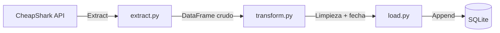

# GameDeals Pipeline

Pipeline de datos que extrae precios de videojuegos desde la API pública de [CheapShark](https://www.cheapshark.com/api/1.0/games), los transforma con pandas, y los almacena en SQLite manteniendo un histórico de precios a lo largo del tiempo.

## Flujo del pipeline



## Stack

- **Python 3.14**
- **requests** — consumo de la API externa
- **pandas** — limpieza y transformación de datos
- **SQLite** — persistencia (vía `sqlite3`, incluido en la librería estándar)
- **logging** — trazabilidad de cada corrida

## Cómo correrlo

```bash
python -m venv venv
venv\Scripts\activate.bat
pip install -r requirements.txt
python main.py
```

Los juegos a trackear se configuran en `config.json`, sin tocar código:

```json
{
    "juegos": ["zelda", "elden ring", "hollow knight"]
}
```

## Decisiones de diseño

- **Histórico en vez de snapshot único**: cada corrida se agrega a la tabla (`if_exists="append"`) en vez de reemplazar los datos anteriores, con una columna `fecha_extraccion`. Esto permite analizar evolución de precios en el tiempo, no solo un estado puntual.
- **SQLite en vez de un servidor de base de datos**: para este alcance (un pipeline personal, sin múltiples usuarios concurrentes), un archivo único es suficiente y elimina la necesidad de levantar infraestructura adicional.
- **Configuración separada del código** (`config.json`): permite modificar qué se trackea sin tocar ni redeployar código — mismo principio que se aplica en pipelines de datos reales.
- **Manejo de errores por ítem**: si falla la extracción de un juego puntual, el pipeline continúa con el resto en vez de abortar por completo.

## Orquestación

Actualmente programado con **Task Scheduler de Windows** para correr una vez por día. En un entorno productivo, este tipo de pipeline se orquestaría con una herramienta como **Apache Airflow**, que permite manejar dependencias entre tareas, reintentos automáticos y monitoreo — fuera del alcance de este proyecto personal, pero el próximo paso natural para escalarlo.

## Próximos pasos

- Migrar la orquestación a Airflow
- Incorporar el endpoint `/deals` de CheapShark para calcular porcentaje de descuento real
- Dashboard simple para visualizar la evolución de precios